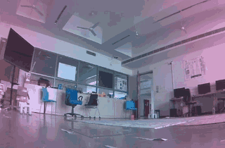
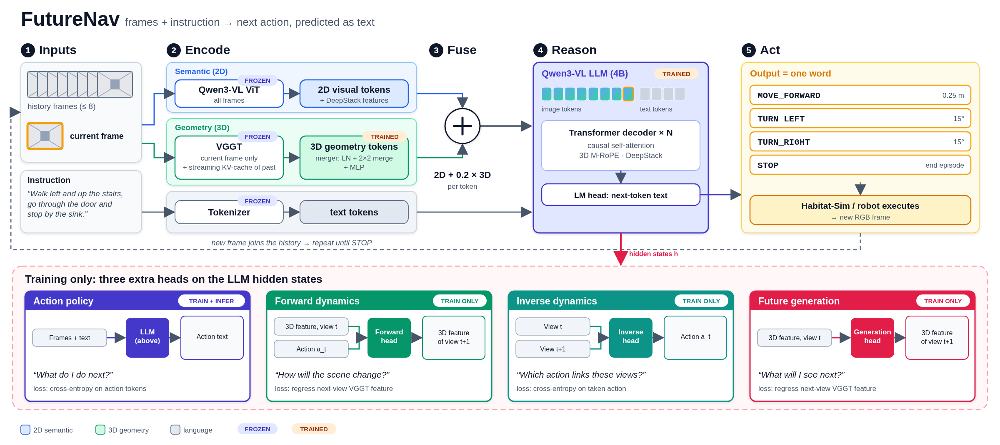

# FutureNav on Real Robots: Deploying and Improving a 5B Vision-Language Navigation Model

<p>
  
  
  
  
  
</p>

I took **[FutureNav](https://github.com/linglingxiansen/FutureNav)**, a 5.5B-parameter
vision-language-action model for indoor navigation ("walk past the sofa and stop at the red door"),
and worked on three things it doesn't do out of the box:

1. **Run it on real robots.** It needs about 23 GB of VRAM, so it can't run on a Jetson. I built a thin-client
   stack where the robot streams camera frames to a GPU server and executes the actions it gets back.
   It runs on a JetRacer (Ackermann steering, fisheye camera) and a TurtleBot3 Waffle (FLIR camera),
   over Zenoh / ROS 2.
2. **Make it move better.** I trained a waypoint head with LoRA on top of the frozen model, added a
   continuous pose executor and a LiDAR local planner (a fast "System 1" under the slow VLA "System 2"),
   and built the data engine that generates its training data.
3. **Understand why it fails.** I built the tooling for that: per-step activation capture on every layer, in
   simulation and on the robot, plus hooks for probes, counterfactual re-queries, scripted derailments and
   activation steering. The findings are part of a paper in preparation and will be added after publication.

<p align="center">
  <br>
  <sub>JetRacer onboard camera during a real-world instruction-following run (sped up 2.5×).</sub>
</p>

---

## Highlights

| Area | Result |
|---|---|
| **Sim-to-real** | Thin-client deployment on two robots. Calibrated fisheye rectification, color correction, Ackermann motion primitives and safety gates. Every step records its full activations for later analysis. |
| **Sim-to-real cost** | A custom Habitat action space that turns in arcs like a car: Ackermann steering costs **−14 pp** success rate (49.3% → 35.3%). A 0.12 m camera costs only ~4 pp. |
| **Systems debugging** | Found and fixed an out-of-memory bug in the upstream VGGT cache trim: a transient second copy of the ~8.9 GB cache pushed peak memory to 23.2 GB on a 24 GB card. |
| **System 1 / System 2** | A LiDAR local planner (A\* + DWA-style arc sampling) follows the VLA's plan and re-queries the 5B model only on triggers (plan used up, off plan, blocked) instead of at every step. Its behaviour is covered by CPU tests in CI. |
| **Better policy** | LoRA waypoint head + continuous executor: **SR 0.627 vs 0.547** for the released model on 300 unseen episodes (57 vs 33 paired wins, McNemar p = 0.015). |

---

## Architecture

<p align="center">
  
</p>

FutureNav fuses Qwen3-VL (2D semantics) with VGGT (3D geometry, kept as a streaming KV cache that is the
model's only spatial memory) and outputs one discrete action per step. The deployment wraps that in:

```
Robot (Jetson Nano / Raspberry Pi)              Workstation (RTX 4090, 24 GB)
┌──────────────────────────────────┐            ┌──────────────────────────────────┐
│ camera ─► rectify + color-correct│   JPEG     │ server/server.py                 │
│                                  │ ─────────► │   FutureNav policy (bf16, SDPA)  │
│ client ─► motion primitives      │  Zenoh /   │   VGGT KV cache, one per episode │
│        ─► safety gates           │  HTTP      │   monotonic step counter         │
│        ─► recorder (video,       │ ◄───────── │   activation capture (all layers)│
│           actions, activations)  │   action   │                                  │
│ [optional] LiDAR System 1        │            │ [optional] waypoint head (LoRA)  │
└──────────────────────────────────┘            └──────────────────────────────────┘
```

The VGGT cache is append-only, so a replayed or dropped frame silently corrupts every later decision. The
server enforces a monotonic step counter for this reason. There's a full compute and memory breakdown
(~49 TFLOP and ~22 GB per step) and a hardware feasibility table in
[docs/ARCHITECTURE.md](docs/ARCHITECTURE.md).

---

## Selected results

### Waypoint head and continuous execution (val_unseen, n = 300)

| Model | SR | SPL |
|---|---|---|
| FutureNav (released) | 0.547 | 0.490 |
| + LoRA, text plan | 0.573 | 0.535 |
| **+ LoRA waypoint head, continuous executor** | **0.627** | **0.565** |

Continuous executor vs the released model: 57 vs 33 paired episode wins (exact McNemar, p = 0.015).
There are more details in [docs/RESULTS.md](docs/RESULTS.md).

---

## Repository layout

| Path | What it is |
|---|---|
| [`server/`](server) | GPU inference server, policy wrapper, waypoint/chunk head servers, camera and motion calibration, eval launchers |
| [`robot/`](robot) | Robot client over Zenoh: robot profiles (JetRacer, Waffle), camera pipeline, motion primitives, guards, run recorder, activation capture, diagnostics |
| [`sim/`](sim) | Habitat extensions: Ackermann action space, continuous pose executor, LiDAR local planner (System 1), remote-agent client |
| [`patches/`](patches) | My changes to upstream FutureNav (`eval/run.py`, `eval/agent.py`, model code) as a single patch |
| [`research/`](research) | Data engine, LoRA waypoint-head training, alternative heads, closed-loop benchmarks, VGGT depth study |
| [`tests/`](tests) | CPU-only tests that run in CI (local planner in a kinematic 2D world) |
| [`docs/`](docs) | Architecture deep-dive, results summary, media |

---

## Getting started

### 1. Upstream model and simulator

```bash
git clone https://github.com/linglingxiansen/FutureNav.git
cd FutureNav
git apply /path/to/futurenav-robotics/patches/futurenav.patch
```

Follow the upstream README for Habitat-Sim/Lab 0.1.7, the R2R VLN-CE data and the
[`llxs/FutureNav`](https://huggingface.co/llxs/FutureNav) checkpoint. Then link this repo's directories into the
checkout (the scripts read its location from `FUTURENAV_ROOT`, default `~/FutureNav`):

```bash
export FUTURENAV_ROOT=~/FutureNav
ln -s /path/to/futurenav-robotics/server   $FUTURENAV_ROOT/deploy
ln -s /path/to/futurenav-robotics/research $FUTURENAV_ROOT/experiments
cp /path/to/futurenav-robotics/sim/*.py    $FUTURENAV_ROOT/eval/
```

### 2. Run the inference server (GPU, ≥ 24 GB)

```bash
cd $FUTURENAV_ROOT
python deploy/server.py --checkpoint pretrain_models/FutureNav-4B-Base --attn sdpa --port 8642
```

### 3. Drive a robot

```bash
cd robot
bash run_bot1.sh "Go through the doorway on your right and stop at the red door." --max-steps 60
```

`robot/dry_run.sh` runs the whole loop without moving the motors.

### 4. Tests (CPU only)

```bash
pip install -r requirements-dev.txt
pytest -q
```

---

## Tech stack

**ML:** PyTorch, Hugging Face Transformers, PEFT/LoRA, Qwen3-VL, VGGT, activation capture and steering hooks
**Simulation:** Habitat-Sim/Lab, Matterport3D, R2R VLN-CE
**Robotics:** Zenoh, ROS 2 (zenoh-bridge-ros2dds), OpenCV fisheye calibration, Ackermann kinematics, A\* + DWA local planning
**Statistics:** paired McNemar tests, bootstrap confidence intervals

---

## Acknowledgements

This project builds on [FutureNav](https://github.com/linglingxiansen/FutureNav) (model, weights and Habitat
evaluation code). That code isn't redistributed here. The patch in `patches/` modifies an upstream checkout,
and its context lines come from the upstream files. Qwen3-VL, VGGT, Habitat and Matterport3D are used under
their respective licenses.

## License

My code in this repository is released under the [MIT License](LICENSE). Upstream components keep their
original licenses.
